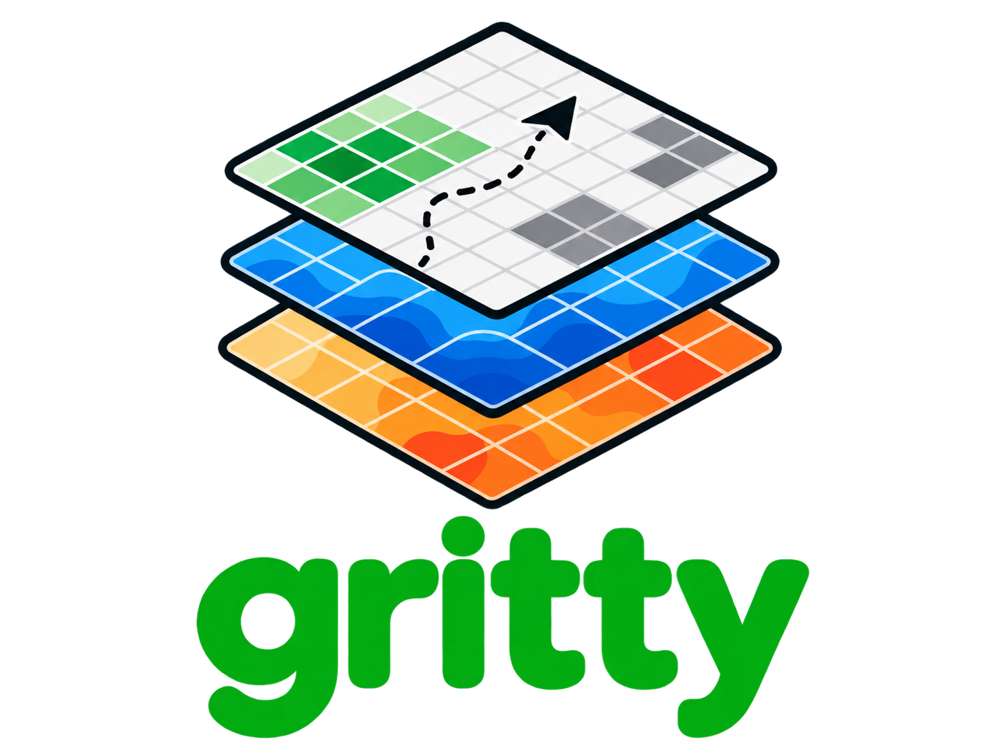

# griddy

A flexible,modern C++20 grid mapping library for robot autonomy. As typical autonomy stacks move into modern-er C++ language paradigms, its useful to explore how battle-tested software like occupancy grid mapping can evolve along with the language to become more expressive, faster and safer. griddy is my humble attempt at that. This project aims to reach feature-parity with nav2 and perhaps present useful ways we can improve things
